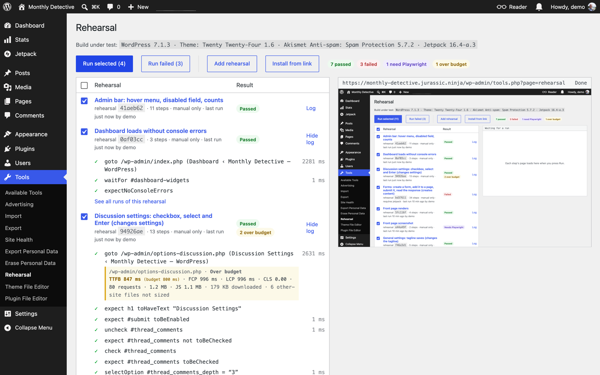
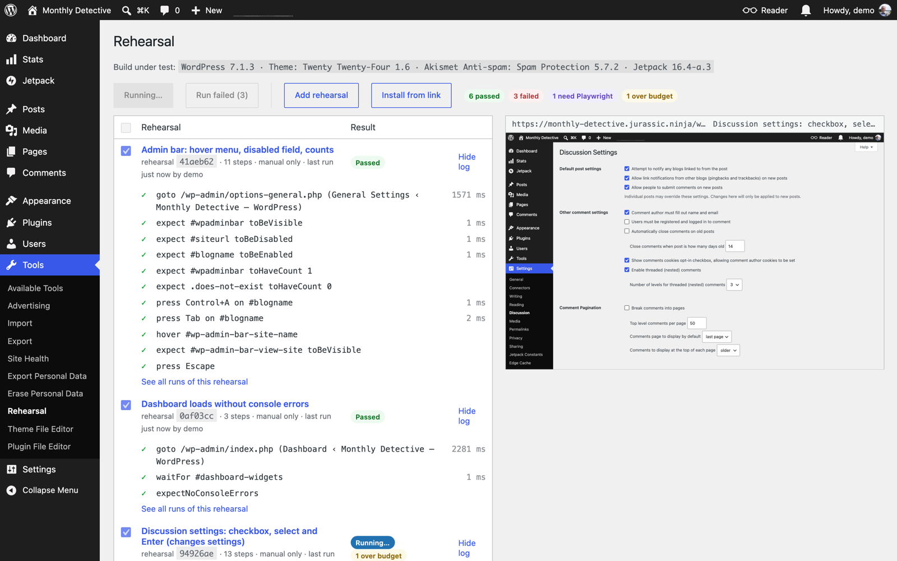
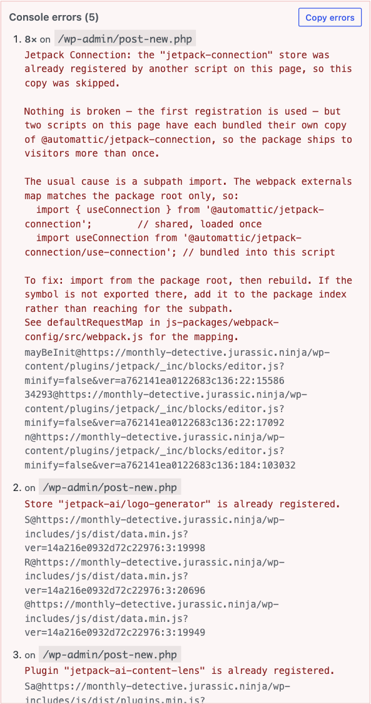
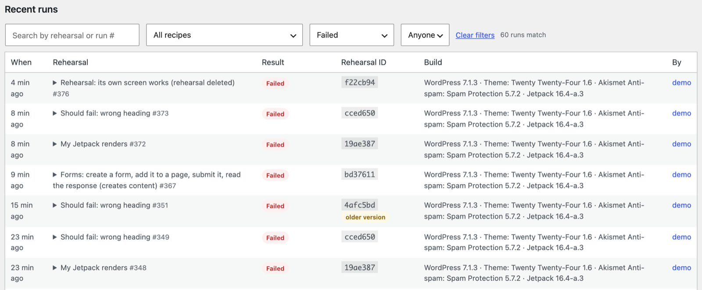
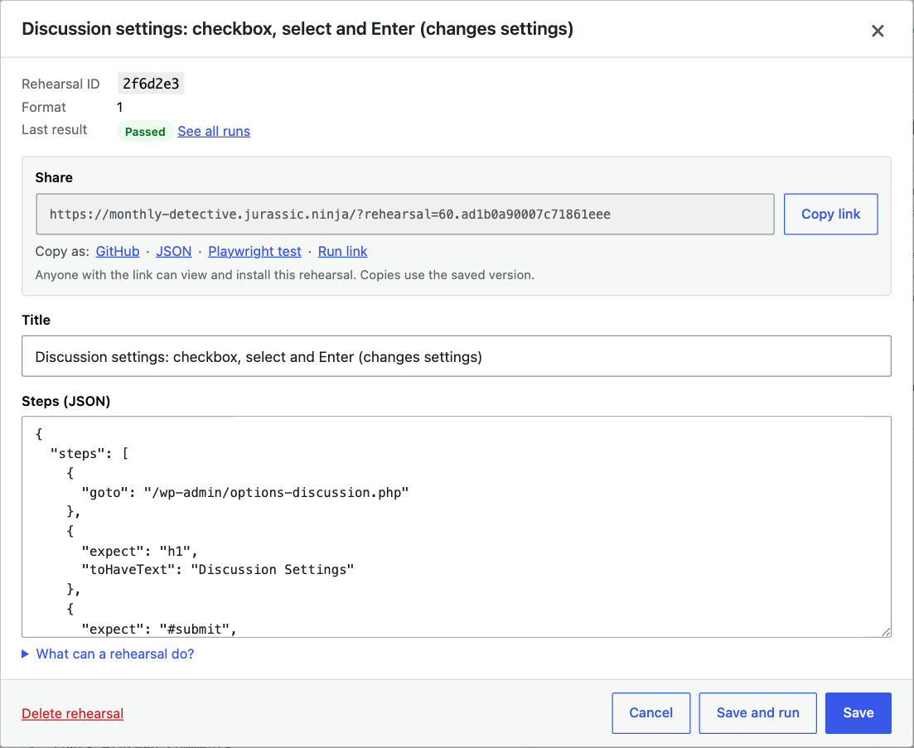
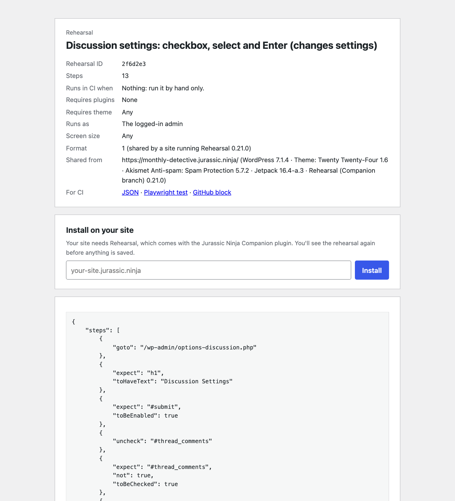
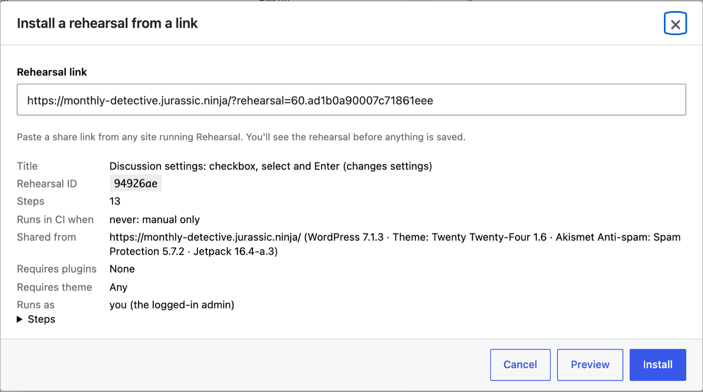
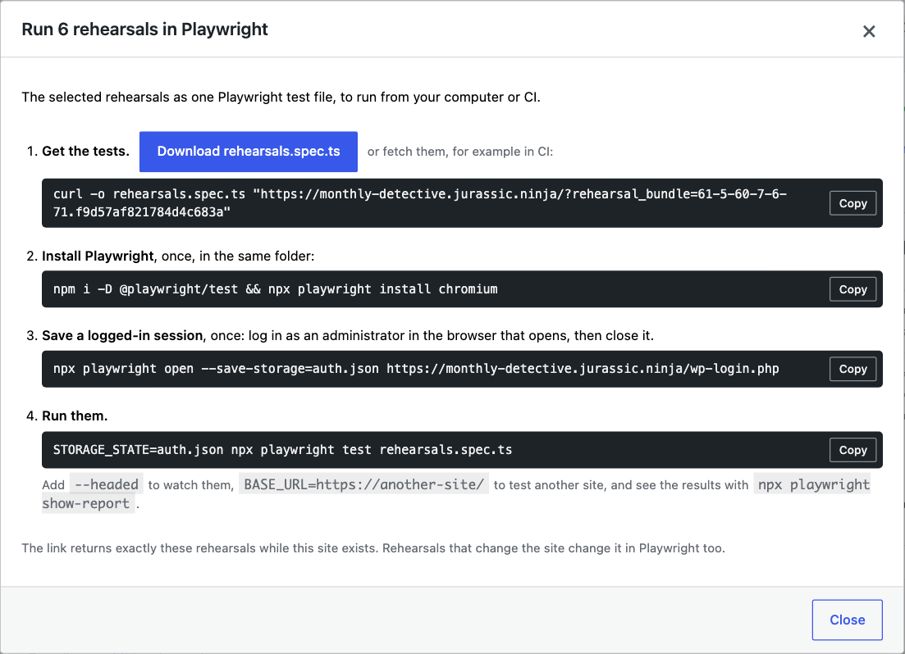

# Rehearsal

Rehearsal runs repeatable, step-by-step checks of a Jurassic Ninja site from **Tools → Rehearsal**. A
rehearsal is a short JSON list of steps (go to a page, click, fill, expect). It runs in your browser,
against the site you are logged into, and every run is saved on the site as a read-only record.

It exists so that whoever verifies a change, the author, a reviewer or an agent, can repeat the same
check the same way, and compare results by a rehearsal ID that only changes when the steps do.



## Quick start

1. Open **Tools → Rehearsal** on a Jurassic Ninja site.
2. Press **Add example rehearsals**. You get a few rehearsals that work on any site, Jetpack ones when
   Jetpack is active, and **Rehearsal: its own screen works**, which tests this screen itself.
3. Tick the ones you want and press **Run selected**. Each step's page loads in the frame on the right.

Click a rehearsal's title to view, edit, share or run it. **Run failed** re-runs only the ones whose
latest result failed.



While a run goes, a bar at the top shows which rehearsal and step it is on, the time so far, and about
how long is left. **Run selected** shows the estimate before you start. Estimates come from each
rehearsal's last run: the whole run when it passed, its pace per step when it stopped early (failed
steps don't count, since they mostly wait out a timeout), and a guess from the other rehearsals when it
has never run.

Above the frame:

- **Desktop / Mobile** sets the size pages render at. Desktop is at least 1280 × 800, scaled to fit.
  Mobile is a phone's 390 × 844, so pages use their mobile layout. Only the size changes: the browser
  still says it is a desktop browser, so server-side checks such as `wp_is_mobile()` see desktop. A run
  keeps the size it started with; mobile runs say so in their log and in **Recent runs**. A rehearsal
  with a `viewport` setting always runs at that size, whatever the switch says.

The switch is remembered in your browser.

## Writing a rehearsal

Press **Add rehearsal**, give it a title, and write its steps:

```json
{
  "requires": [ "jetpack" ],
  "steps": [
    { "goto": "/wp-admin/options-discussion.php" },
    { "expect": "h1", "toHaveText": "Discussion Settings" },
    { "check": "#thread_comments" },
    { "selectOption": "#thread_comments_depth", "value": "3" },
    { "press": "Enter", "on": "#comments_per_page" },
    { "expect": "#setting-error-settings_updated", "toContainText": "Settings saved" },
    { "expectNoConsoleErrors": true }
  ]
}
```

Saving checks the JSON against everything below and tells you what is wrong. Each step has exactly one
action.

### Steps

| Step | What it does |
| --- | --- |
| `{ "goto": "/wp-admin/…" }` | Loads a page of this site. Paths under `/wp-admin/` use the admin URL, others the home URL. |
| `{ "click": sel }` | Clicks once the element is enabled, as Playwright does. A link that opens a new tab loads in the frame instead. |
| `{ "fill": sel, "value": "…" }` | Types into an input or textarea (works with React-controlled fields). |
| `{ "check": sel }` / `{ "uncheck": sel }` | Sets a checkbox or radio. A label or wrapper works too. |
| `{ "selectOption": sel, "value": "…" }` | Picks an option by its value, or else its label. |
| `{ "hover": sel }` | Sends the mouse events a pointer would. |
| `{ "press": "Enter", "on": sel }` | Sends a key, such as `Enter`, `Escape`, `Tab` or `Control+A`. |
| `{ "expect": sel, <matcher> }` | Waits until the matcher holds, or fails with what the page showed. |
| `{ "waitFor": sel }` | Waits until something is visible. |
| `{ "expectText": "…", "in": sel }` | Waits until the page (or `in`) contains the text. |
| `{ "expectNoConsoleErrors": true }` | Fails on script errors so far: `console.error`, uncaught errors, rejected promises. Use `{ "ignore": [ "regex" ] }` to skip known ones. |
| `{ "snapshot": sel }` | Saves the element's HTML with the run. |
| `{ "dialog": "accept", "value": "…" }` / `{ "dialog": "dismiss" }` | Answers the next alert, confirm or prompt (`value` is the prompt's text). Put it before the step that opens the dialog. Without one, dialogs are dismissed, as in Playwright. |
| `{ "screenshot": "name" }` | Playwright only; mark the rehearsal `"needs": "playwright"`. |

`expect` takes one matcher, named after Playwright's: `toBeVisible`, `toHaveText` (whole text),
`toContainText`, `toHaveCount`, `toBeEnabled`, `toBeDisabled`, `toBeChecked`, `toHaveValue`. Add
`"not": true` to invert it. The yes-or-no matchers only take `true`: `"toBeVisible": false` is rejected,
because it used to check for visible; write `"toBeVisible": true, "not": true`.

### Selectors

- CSS: `#submit`, `.notice`, `form.contact-form input[type=email]`
- `text=Save settings`: an element containing that text, or whose `aria-label` does (icon buttons)
- `role=button`, `role=table`, … (`role=tab:has-text("Settings")` works too; the Playwright export turns
  it into `.filter( { hasText } )`, since Playwright's own `role=` rejects `:has-text`)
- `:has-text("…")` on the last part of a CSS selector: `tr:has-text("Ada")`
- `a >> b`: `b` inside `a`. When `a` is an iframe, `b` is looked up inside it, which is how you reach
  the block editor: `iframe[name="editor-canvas"] >> [data-type="jetpack/contact-form"]`

Steps act on the first **visible** match.

### Step options

Any step takes `"optional": true` (a failure is logged as skipped, useful for welcome guides that only
sometimes appear) and `"timeout"` in milliseconds. The rehearsal-level `"timeout"` sets the default
(10 seconds). `{{run}}` anywhere in a step becomes a value unique to each run, so a rehearsal can find
the form, page or response it just created.

### Rehearsal settings

| Key | Example | Effect |
| --- | --- | --- |
| `requires` | `[ "jetpack" ]` | Plugins that must be active (folder names or text domains). `"jetpack or jetpack-premium-analytics"` is met by either. Otherwise the rehearsal is disabled. |
| `theme` | `"twentytwentyfour"` or a list | The active theme (a child of it counts). Otherwise disabled. |
| `viewport` | `"desktop"` | Runs only at that size, `"desktop"` or `"mobile"`, whatever the Desktop / Mobile switch says. For steps that only work at one size, such as a button that moves into a menu on phones. |
| `role` | `"editor"` | Runs as a test user with that role (see below). |
| `budgets` | `{ "lcp": 2500, "weight": 2097152 }` | Measures every page load and flags the ones over budget. Without it nothing is measured. |
| `covers` | `[ "packages/forms" ]` | Labels for what the rehearsal exercises, so a CI job can pick rehearsals by what changed. |
| `needs` | `"playwright"` | Skips the browser runner; for rehearsals that need screenshots or other sites. |
| `timeout` | `20000` | Default step timeout in ms. |
| `format` | `1` | The oldest rehearsal format that can run it. Added when the rehearsal is saved; you don't write it. |

### Versions

Every rehearsal records the oldest format that can run it (`"format": 1`), so a rehearsal that uses
nothing new still runs on older sites without a warning. A Companion release raises
`Companion_Rehearsal::FORMAT` when it adds something older versions can't run: a new step, matcher or
setting. Format 2 added the `dialog` step, either-or `requires` and `viewport`. A site whose Rehearsal is older than a rehearsal's format still runs it, but warns in the
list ("Newer format"), in the dialog, before installing, and as the first line of the run log. When
an older version can't even read it, installing explains that the Companion plugin needs updating.
The rehearsal ID ignores the format, so stamping it never makes results stale, and the order of keys,
so `{ "fill", "value" }` and `{ "value", "fill" }` are the same rehearsal. Runs saved before IDs
ignored key order are matched by the steps they stored, so they don't turn stale either.

Budget keys are `ttfb`, `fcp`, `lcp` (ms), `cls`, `requests`, `weight` and `js` (compressed bytes).
Going over is a notice, never a failure.

### Tips

- Make what you create unique with `{{run}}`, then find it again: `tr:has-text("Ada Verify {{run}}")`.
- Before leaving a page, wait for its confirmation. A `goto` straight after a click can cancel the save
  that click started.
- A click that loads another page isn't waited for, here or in Playwright. Next, expect something that
  is only on the new page; otherwise the step can still match the old one.
- Close welcome guides with an optional step:
  `{ "click": "[role=dialog] button[aria-label=\"Close\"]", "optional": true, "timeout": 4000 }`.
- Steps that change the site say so in the title, like the examples do.

## Reading results

Each rehearsal's log shows every step and how long it took. A failing step says what it waited for and
what the page showed instead. Script errors are grouped, with the page and the script that logged them,
and **Copy errors** puts a plain-text report on the clipboard to pass on.



Results are kept per rehearsal ID. Editing a rehearsal marks its last result **Stale** until it runs
again. **Recent runs** lists every run and can be filtered by rehearsal, result and who ran it, or
searched by title or run number (`#233`).



## Sharing

The **Share** box in the rehearsal dialog has a link, three copies and a run link:

- **Share link**: `https://<site>/?rehearsal=<id>.<key>`. Opened in a browser it shows the rehearsal
  and an **Install on your site** box. With `&format=json` it returns the rehearsal for scripts and CI.
  The key is unique to the rehearsal, so the link reveals nothing else.
- **Copy as GitHub**: a summary with the last result and the JSON folded away, for a PR description.
  The server builds it, so it is the same as `<share link>&format=github` and `wp rehearsal block <id>`.
- **Copy as JSON**: the raw steps.
- **Copy as Playwright test**: a standalone `.spec.ts` (see below).
- **Run link**: opens this screen and runs the rehearsal straight away (see below).



Installing from a link shows the rehearsal first, and warns when this site is missing a required
plugin, theme or role. The copy keeps the same rehearsal ID, so results compare across sites.
Installing the same link again updates that copy.





Share links stop working when the site that holds the rehearsal expires.

## Running rehearsals in Playwright

Select rehearsals and press **Run in Playwright**. It exports them as one `rehearsals.spec.ts`, one
`describe` block each with its own timeout, role and budgets, and lists the commands to run it:

1. **Get the tests**: the download button, or `curl` the signed link it shows (works in CI too).
2. **Install Playwright**, once: `npm i -D @playwright/test && npx playwright install chromium`.
3. **Save a logged-in session**, once: `npx playwright open --save-storage=auth.json https://<site>/wp-login.php`,
   log in as an administrator and close the browser. For rehearsals with a `role`, save one per role
   for a user with that role (`auth-editor.json`); the `rehearsal-<role>` test users have random passwords.
4. **Run**: `STORAGE_STATE=auth.json npx playwright test rehearsals.spec.ts`, plus
   `STORAGE_STATE_EDITOR=auth-editor.json` and so on for roles. `BASE_URL` tests another site.



A single rehearsal is also available as **Copy as Playwright test**, or `<share link>&format=playwright`.
The bundle link is signed like a share link, so it returns exactly the rehearsals it was made for.

Each test saves its result on the site as a run, so it shows in **Recent runs** marked "in Playwright".
It posts with the `STORAGE_STATE` session (an administrator's), with a step-by-step log. Set
`REHEARSAL_REF=<label>` to label the runs, or `REHEARSAL_REPORT=0` to save nothing. A test run against
another site (`BASE_URL`), or after the rehearsal changed, is not saved; the report says why.

In Playwright, screenshots work, every page load starts with an empty cache, and failed network
requests are noted in the report instead of counting as console errors.

## For agents and scripts

`wp rehearsal` does what the screen does, without a browser:

```bash
wp rehearsal save checkout.json --title="Checkout: pays with a test card"   # or pipe JSON in
wp rehearsal list --format=json                    # each rehearsal, its share and run links, last run
wp rehearsal install "https://other-site/?rehearsal=12.abc…" --yes
wp rehearsal runs --rehearsal=12 --ref=task-481 --format=json
wp rehearsal block 12 >> pr-body.md                # the GitHub block for a PR description
```

`save` takes a rehearsal or what a share link returns with `&format=json`. Saving the same title and
steps again, from the CLI or `POST /rehearsal/v1/rehearsals`, returns the rehearsal already saved
(`"existing": true`) instead of a copy.

**Running without clicks.** A run link,
`/wp-admin/tools.php?page=rehearsal&run=<ids>.<key>&ref=<label>` (from `wp rehearsal list` or the
dialog's **Run link**), runs its rehearsals as soon as the screen opens in a logged-in browser. While
it runs, `#rh-app` has `data-run-status="running"`; then `pass`, `fail`, `queued` or `error`, with the
saved run numbers in `data-run-ids`. The runs keep the `ref`, so `wp rehearsal runs --ref=<label>` or
`GET /rehearsal/v1/runs/search?ref=<label>` finds them. The key is checked, so another site can't
link an admin into running something.

## How it works, and its limits

- The runner loads each step's page in a same-origin iframe and drives it with DOM events. A small
  recorder, added to every page but active only inside that frame, collects script errors and page-load
  metrics.
- Block editor pages send `Document-Isolation-Policy`, which would hide the frame from the runner.
  Rehearsal turns off client-side media processing (which sends that header) only for requests from
  the frame while a run is going.
- **Roles**: a test user per role (`rehearsal-editor`, …) is created when first needed and marked as
  Rehearsal's own; an existing account with that name is never used. While a rehearsal with a role runs,
  page loads into frames and the frame's own requests (marked with an `X-Rehearsal-Frame` header) act as
  that user. Only an administrator can do this, and it ends with the rehearsal. A frame in another
  wp-admin tab that loads a page during such a run is switched too.
- Only administrators can see, edit or run rehearsals. Runs cannot be edited once saved.
- The browser runner cannot open other sites (such as the WordPress.com connection flow), take
  screenshots, open menus that only use CSS `:hover`, or type characters with `press` (use `fill`).
  Use the Playwright test for those.
- Browsers slow down timers in background tabs; keep the tab visible while a run is going.

## Development

`class-companion-rehearsal.php` holds the shared names and hooks; each part lives in `includes/`:

| Class | Does |
| --- | --- |
| `Companion_Rehearsal_Schema` | The step vocabulary, validation, and the rehearsal ID |
| `Companion_Rehearsal_Store` | Rehearsal posts: registering, saving, shaping them for the runner |
| `Companion_Rehearsal_Runs` | Saved runs: cleaning what the runner sends, storing, searching |
| `Companion_Rehearsal_Requirements` | Plugins, theme and role a rehearsal needs |
| `Companion_Rehearsal_Roles` | Running as a role's test user |
| `Companion_Rehearsal_Share` | Share links, the share page, JSON and Playwright output |
| `Companion_Rehearsal_Playwright` | Rehearsal → Playwright test |
| `Companion_Rehearsal_Rest` | REST routes |
| `Companion_Rehearsal_Admin` | The screen, its assets, the in-frame recorder, the build line |
| `Companion_Rehearsal_Examples` | The example rehearsals |
| `Companion_Rehearsal_Command` | `wp rehearsal` |

The decisions worth testing are pure functions that take what they need as arguments, such as
`Schema::validate()`, `Requirements::find_missing()`, `Roles::is_from_frame()`,
`Share::id_from_token()` and `Runs::clean_log()`. Their tests run without WordPress:

```bash
composer install
composer test
```
